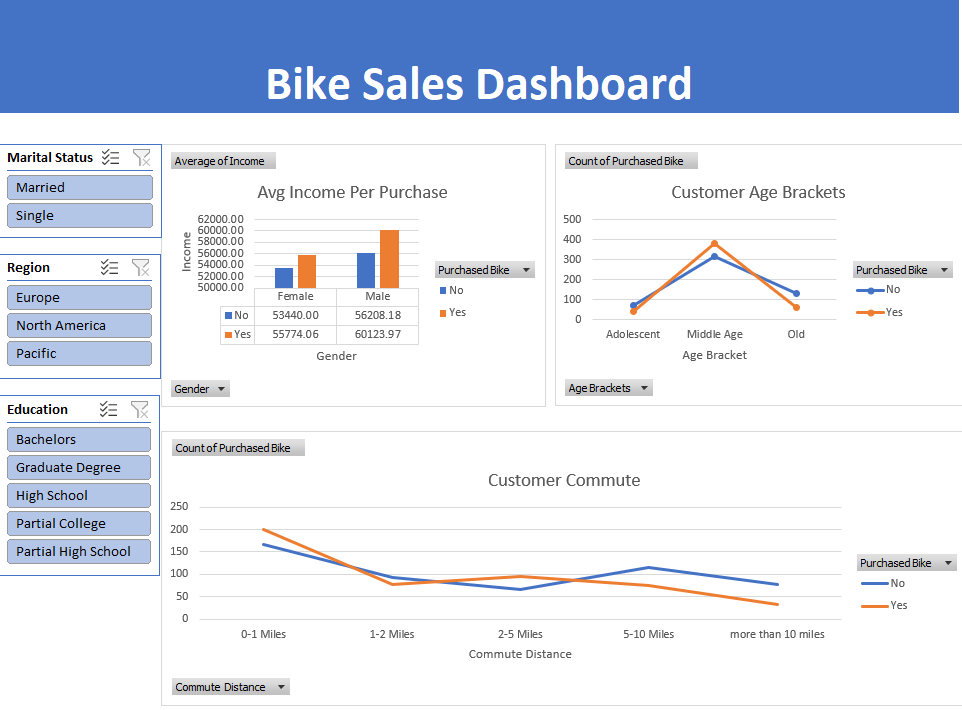

# Bike Sales Excel Dashboard

## Project Overview
Analyzed bike purchasing patterns based on customer demographics, income, age, and commute distance using Microsoft Excel. Created an interactive dashboard to visualize customer purchasing behavior.

## Tools & Technologies
- Microsoft Excel
- Pivot Tables
- Pivot Charts
- Slicers

## Key Analysis
- Average income by gender and bike purchase status.
- Bike purchasing patterns across different age groups.
- Customer purchasing behavior based on commute distance.
- Interactive filtering by marital status, region, and education.

## Excel Skills Demonstrated
Data Cleaning, Data Transformation, Excel Formulas, Pivot Tables, Data Visualization, Slicers, and Dashboard Creation.

## Dashboard Preview

